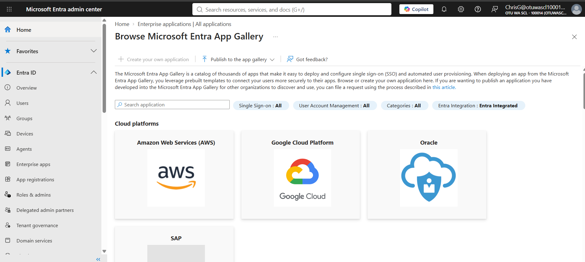
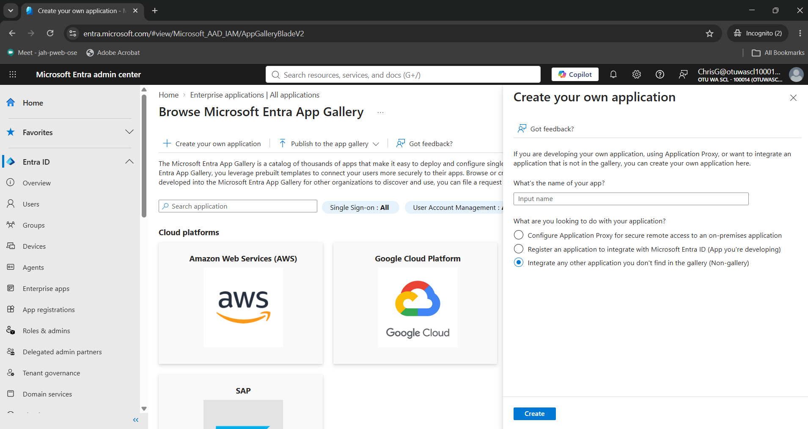
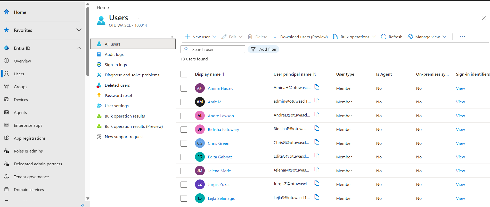
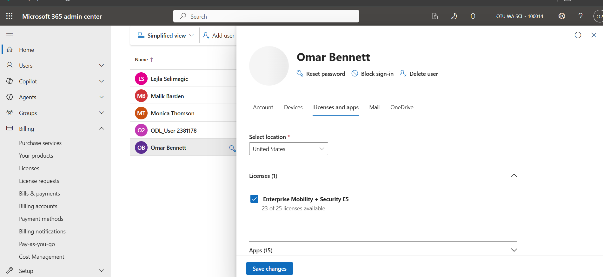
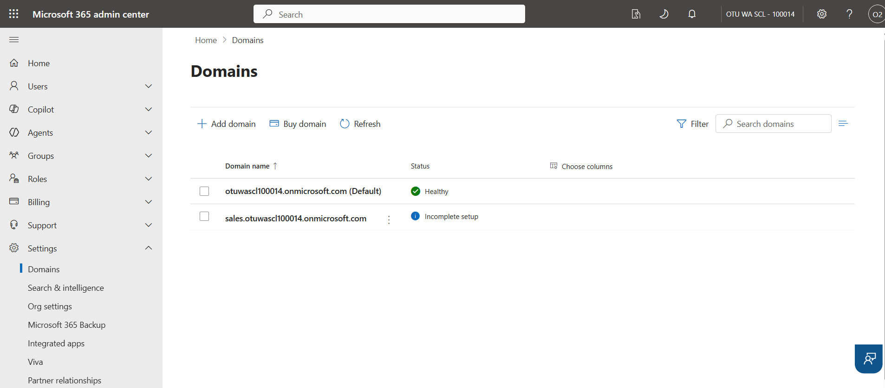
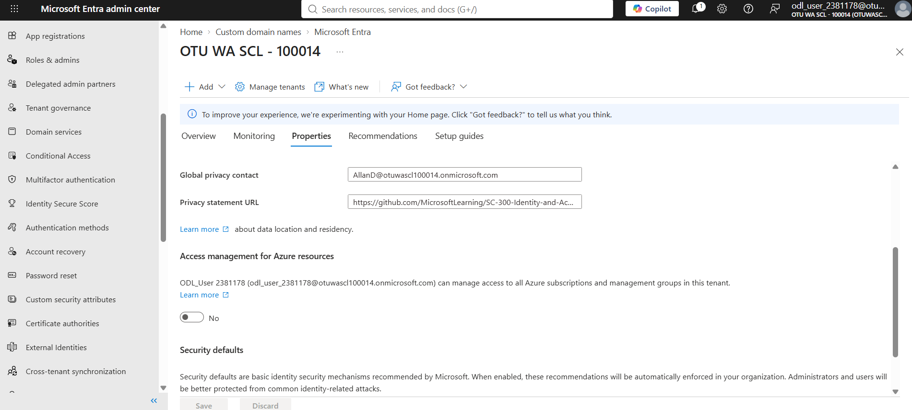
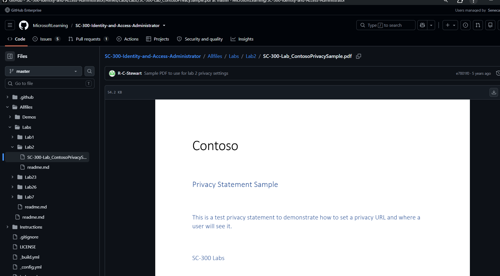
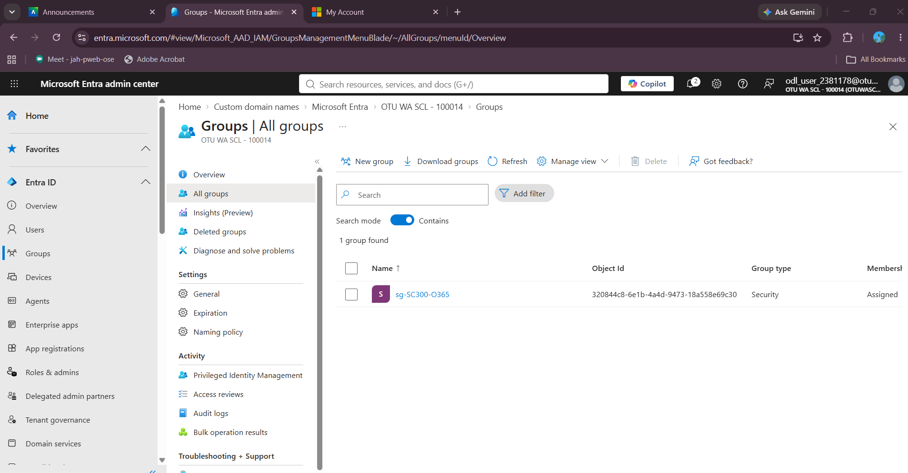
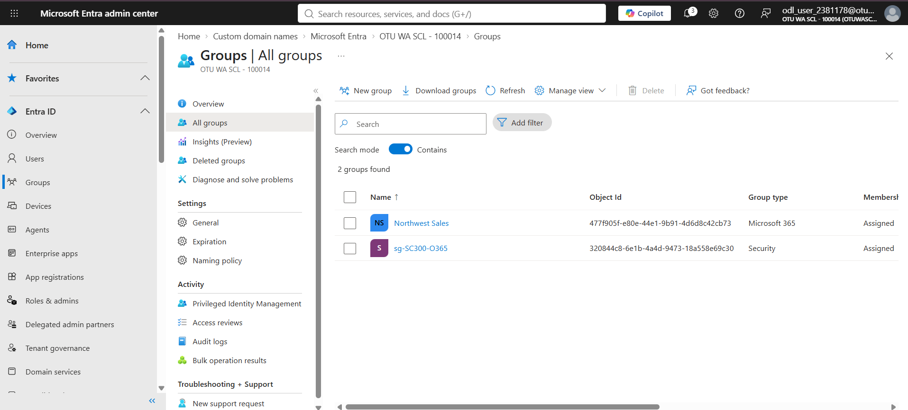
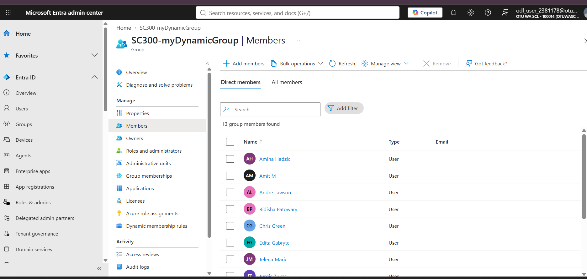

# Week 1 — Entra ID Users, Tenant Settings and Groups

**Course:** IAM500 — Identity and Access Management  
**Platform:** Microsoft Entra ID / Azure (lab tenant)

## Objective

Set up the foundations of a Microsoft Entra ID tenant: delegating admin roles, provisioning users in bulk, assigning licenses, adding a custom domain, configuring tenant privacy details, and building static and dynamic groups.

## Lab 01 — Users and role delegation

Before any role was assigned, the new user signed in but could not manage enterprise applications — showing least privilege by default.

*Figure: New user signed in without application-management rights*

Assigned the user an application-administration role in Entra ID; the user could then create an enterprise application.

*Figure: Role assigned to the new user*

Created several users at once with the Bulk create CSV upload.

*Figure: Bulk user creation completed*

Assigned a Windows 10 license to the user.

*Figure: Windows 10 license assigned*

## Lab 02 — Tenant configuration

Added a custom subdomain to the tenant.

*Figure: Custom subdomain added*

Set the tenant's privacy contact and privacy statement URL.

*Figure: Privacy contact configured*

*Figure: Privacy statement saved*

## Lab 03 — Groups

Created a security group for access control.

*Figure: Security group created*

Created a Microsoft 365 group for collaboration.

*Figure: Microsoft 365 group created*

Created a dynamic group whose membership rule automatically includes all users.

*Figure: Dynamic group with an all-users rule*

## Key takeaways

- Role-based access control: users get no admin rights until a role is assigned.
- Bulk operations and dynamic membership rules cut manual identity work.
- Security groups control access; Microsoft 365 groups add collaboration resources.
