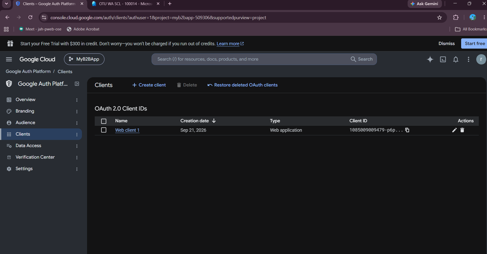
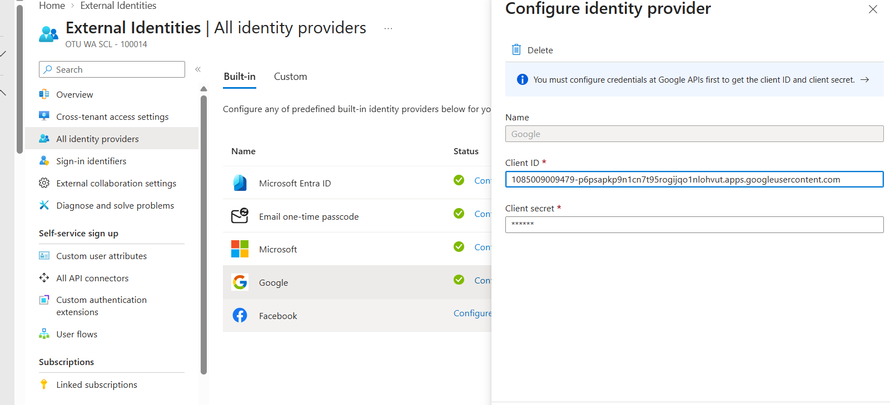
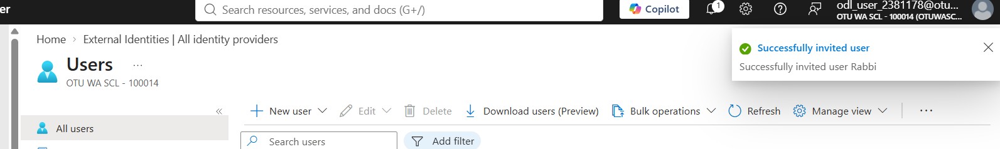
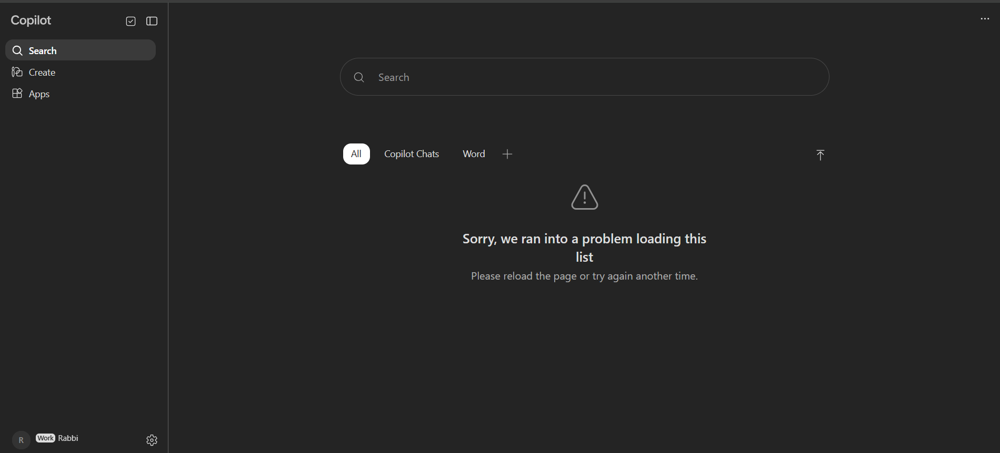
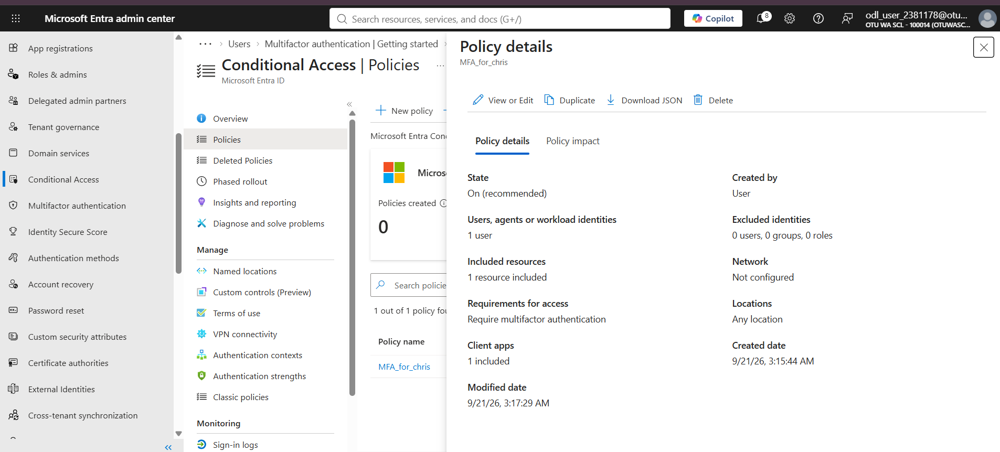
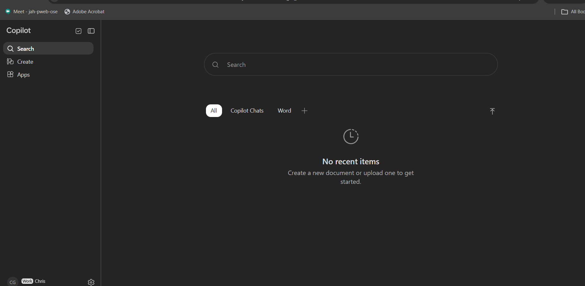

# Week 2 — External Identities (Google Federation) and MFA with Conditional Access

**Course:** IAM500 — Identity and Access Management  
**Platform:** Microsoft Entra ID / Azure (lab tenant)

## Objective

Federate Google as an external identity provider for B2B guest access, then enforce multi-factor authentication with a Conditional Access policy.

## Lab 06 — Google as an external IdP

Created an OAuth 2.0 web client in Google Cloud for the Entra ID federation.

*Figure: OAuth 2.0 client created in Google Cloud*

Added Google as an identity provider under External Identities.

*Figure: Google configured as an external IdP*

Invited a Gmail test user as a B2B guest.

*Figure: Guest invitation sent*

Signed in to login.microsoftonline.com with the Google account — federation works.

*Figure: Successful sign-in with the Google identity*

## Lab 08 — MFA with Conditional Access

Built a Conditional Access policy requiring MFA for the target user (tested with an account already enrolled in Microsoft Authenticator).

*Figure: Conditional Access policy requiring MFA*

Signed in as that user and was challenged for MFA.

*Figure: MFA prompt during sign-in*

## Key takeaways

- Federation lets partners use their existing identities, so no extra passwords are created.
- Conditional Access ties sign-in requirements (like MFA) to users, apps and conditions.
