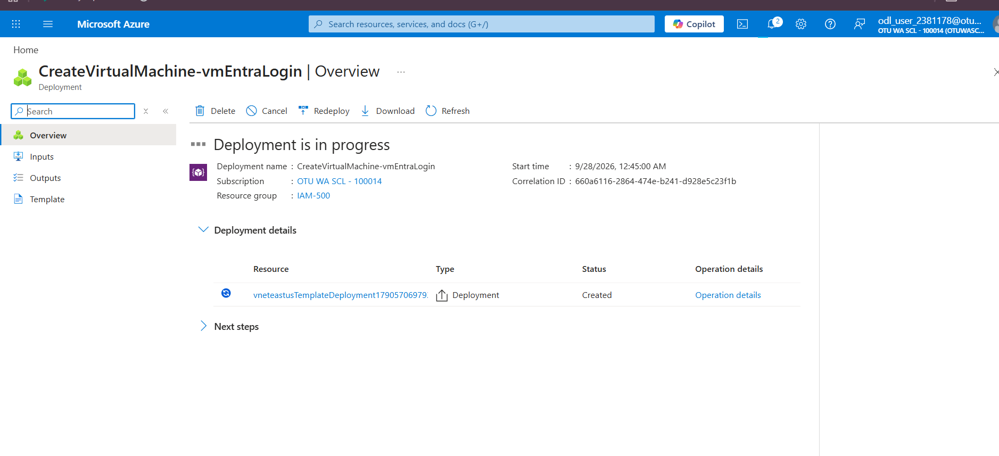
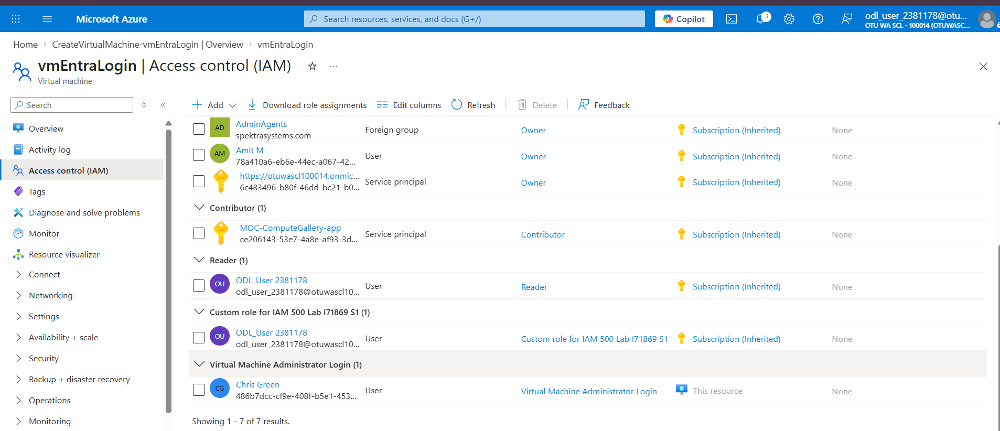
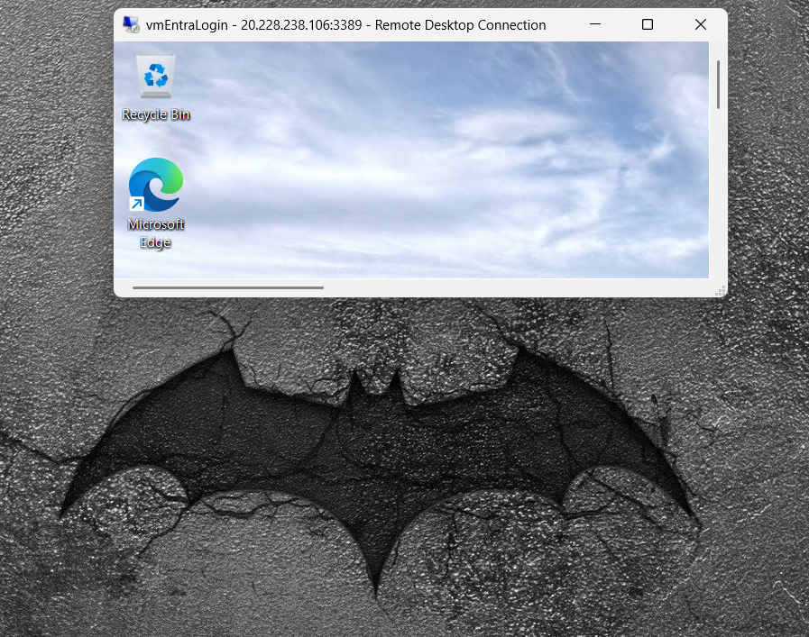
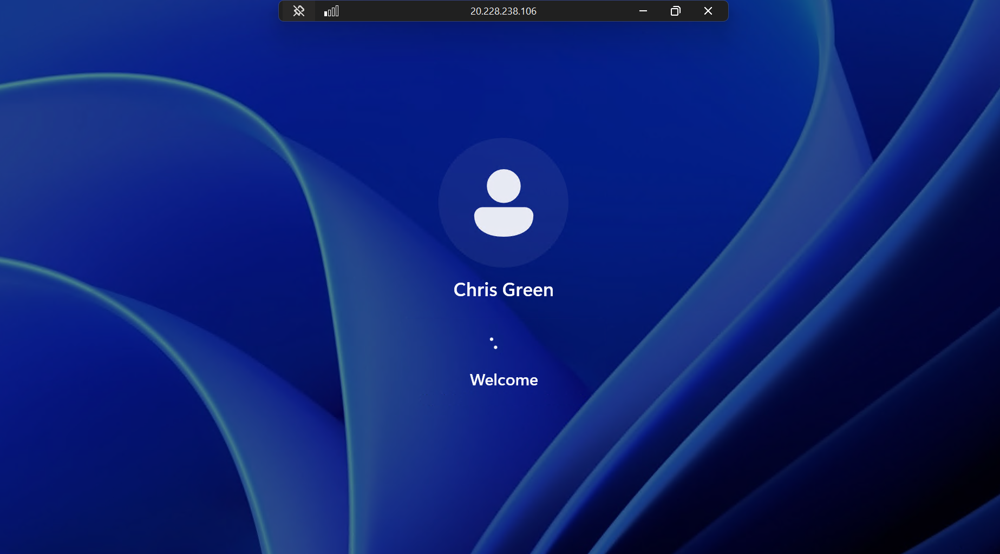
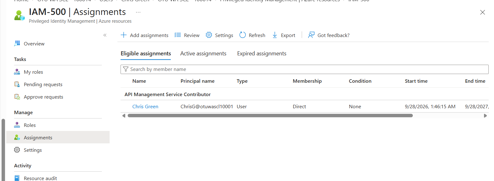
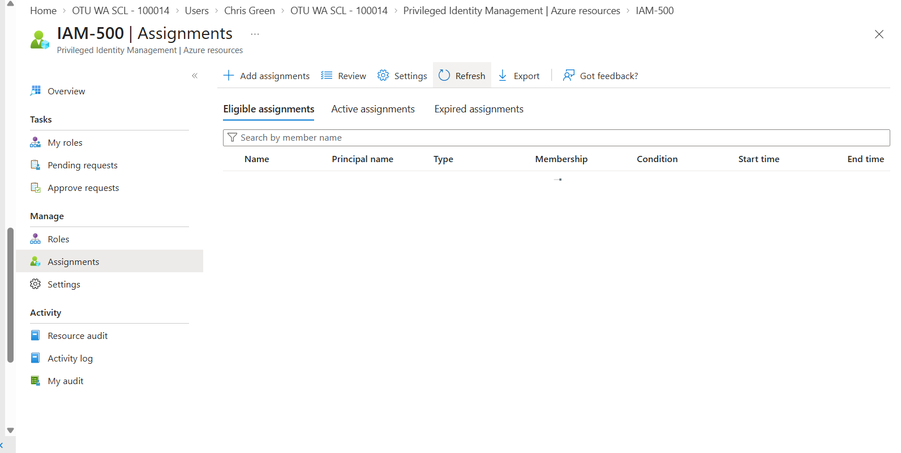
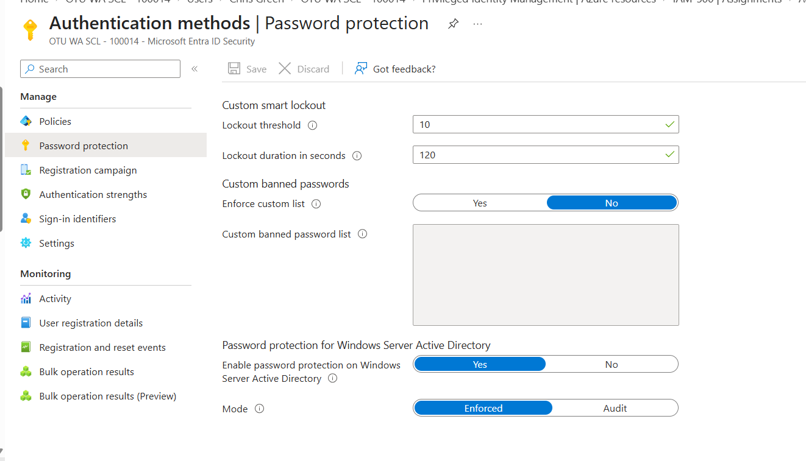
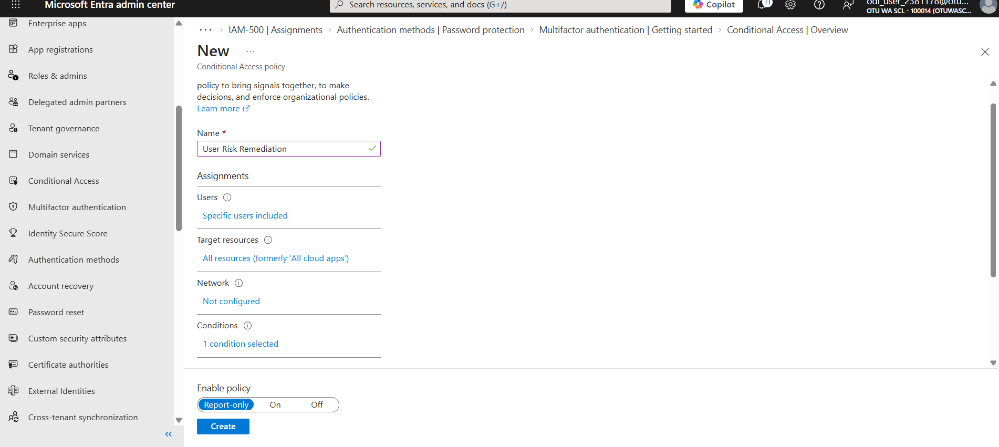
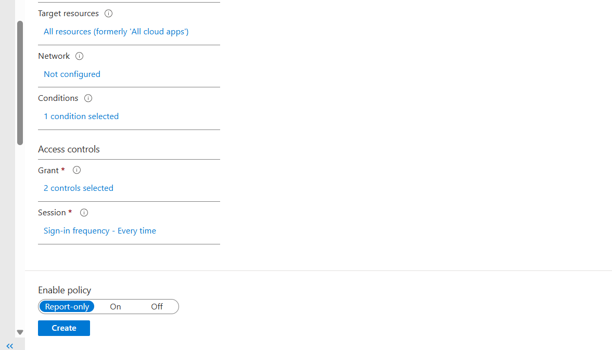

# Week 3 — Azure RBAC, VM Sign-in with Entra ID, and Account Lockout

**Course:** IAM500 — Identity and Access Management  
**Platform:** Microsoft Entra ID / Azure (lab tenant)

## Objective

Deploy an Azure VM that uses Entra ID sign-in, control who can log in through Azure RBAC, manage role assignments, and tune Smart Lockout.

## VM deployment and Entra ID login

Deployed the Windows VM.

*Figure: VM deployment in progress*

Gave the test user (Chris G) a VM login role.

*Figure: VM login role assigned*

Connected over Remote Desktop.

*Figure: RDP session to the VM*

Signed in to the VM with the test user's Entra ID account.

*Figure: Entra ID user signed in to the VM*

## Role lifecycle

Added a new role assignment …

*Figure: New role assigned*

… and removed it again to show clean de-provisioning.

*Figure: Role assignment removed*

## Smart Lockout and Conditional Access

Raised the lockout duration to 120 seconds to slow brute-force attempts.

*Figure: Lockout duration set to 120 seconds*

Reviewed Conditional Access policy settings (inspected without creating the policy).

*Figure: Conditional Access settings*

*Figure: Conditional Access settings (continued)*

## Key takeaways

- Azure RBAC decides who can sign in to a VM; Entra ID removes the need for local accounts.
- Smart Lockout settings trade user friction against password-spraying resistance.
