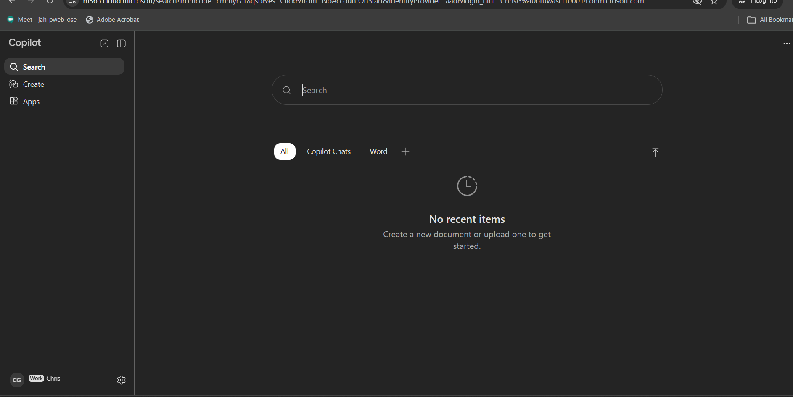
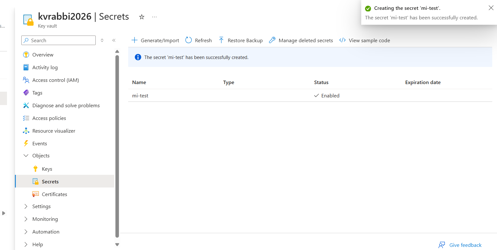
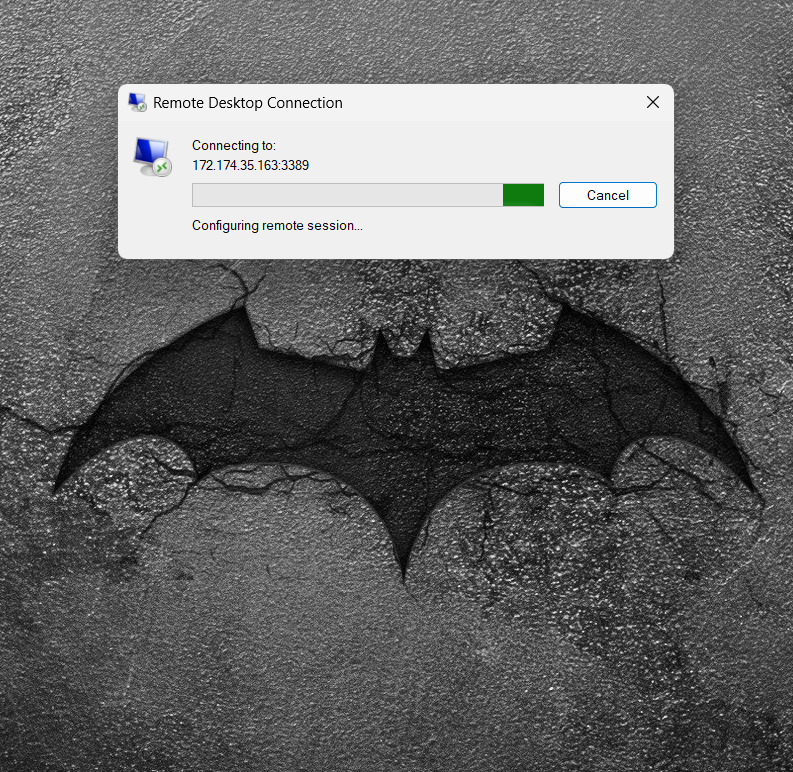
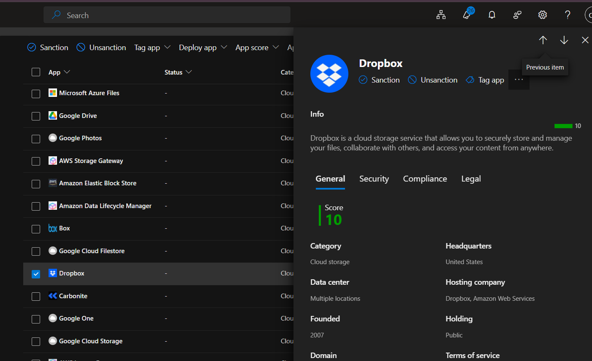
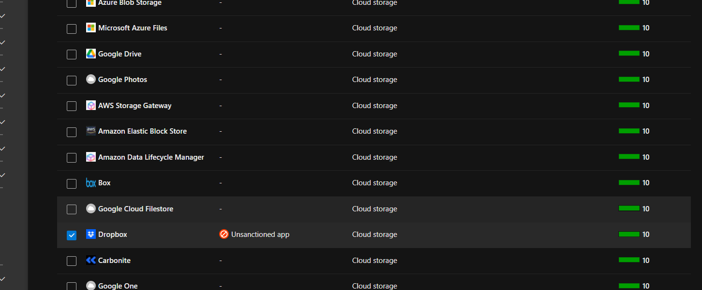
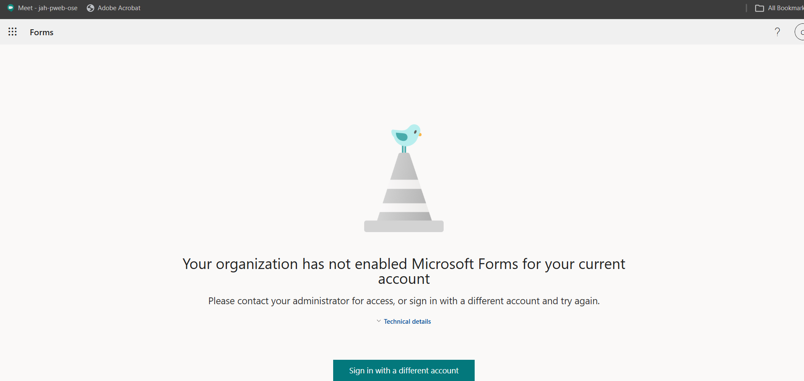
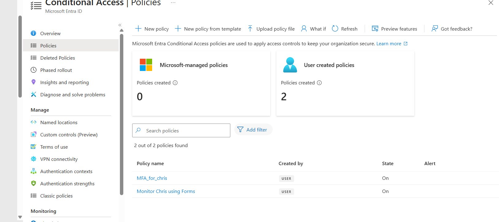
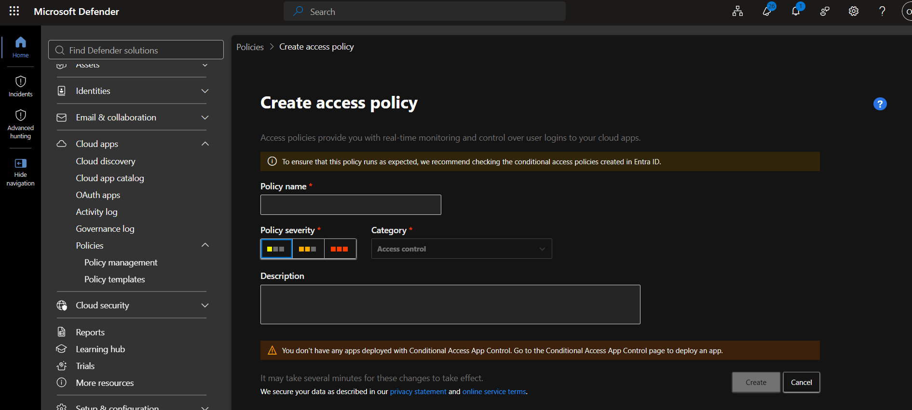

# Week 4 — Managed Identities, Key Vault, Defender for Cloud Apps and Identity Protection

**Course:** IAM500 — Identity and Access Management  
**Platform:** Microsoft Entra ID / Azure (lab tenant)

## Objective

Secure workload secrets with Key Vault and managed identities, then use Microsoft Defender for Cloud Apps and Entra ID Protection to find and control risky apps and sign-ins.

## Secrets and MFA

At the end of Task 2, MFA was required for the test user.

*Figure: MFA required for the user*

Created a secret in Azure Key Vault for a managed identity to read.

*Figure: Key Vault secret created*

End of Task 5. *Note: the VM step did not finish after three attempts (15 minutes each) because the lab VM ran out of RAM.*

*Figure: Task 5 result*

## Defender for Cloud Apps

Reviewed an app's risk score in the Cloud App Catalog.

*Figure: Cloud app risk score*

Marked Dropbox as unsanctioned, so access is blocked.

*Figure: Dropbox restricted*

## Identity Protection and alerts

Configured the risk policy for the test user.

*Figure: User risk policy setup*

Created the policy.

*Figure: Policy created*

Created an alert rule.

*Figure: Alert created*

## Key takeaways

- Managed identities with Key Vault keep credentials out of code.
- CASB controls (unsanctioning apps) limit shadow IT.
- Risk-based policies respond to compromised users automatically.
