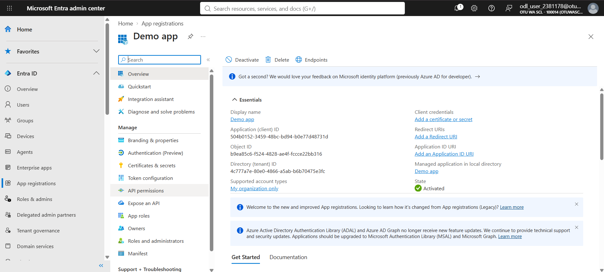
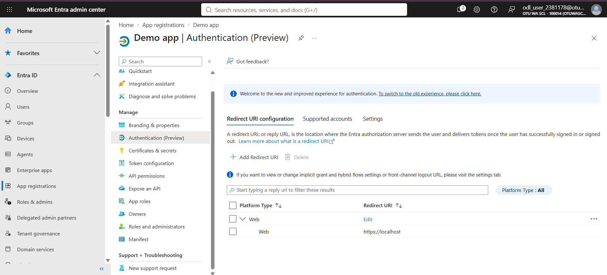
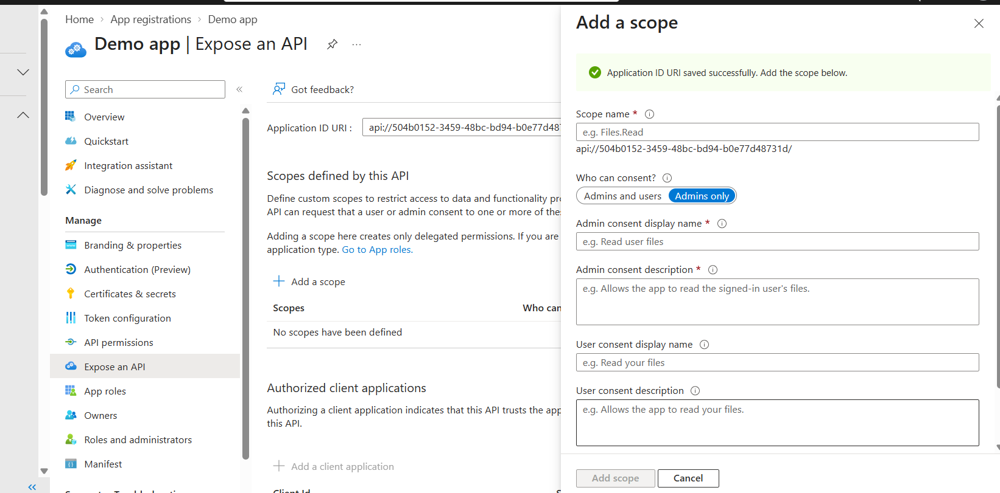
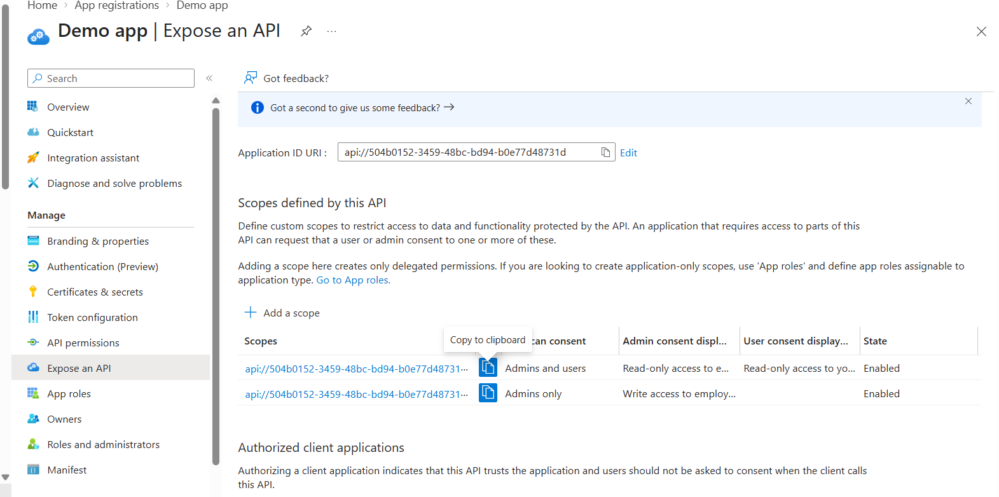
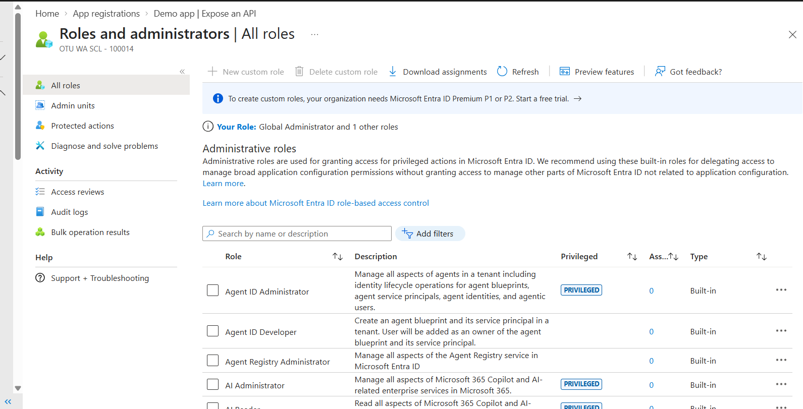
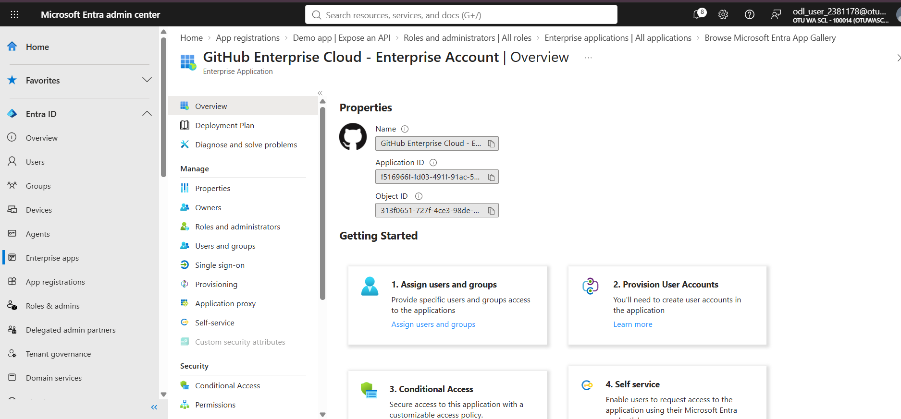
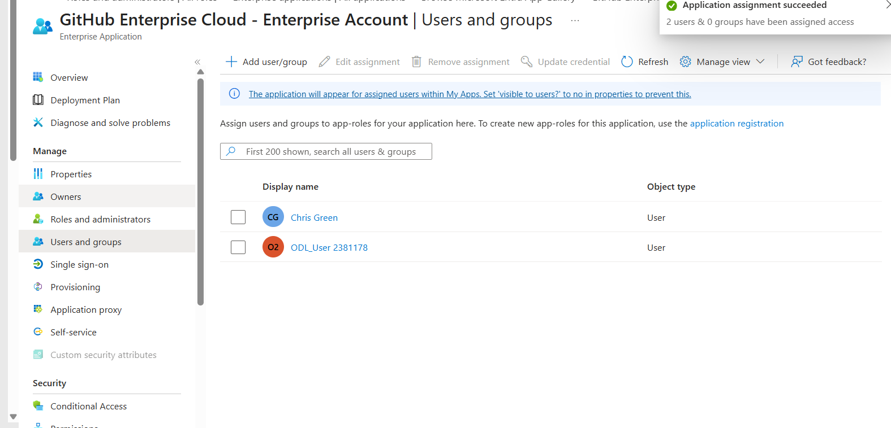
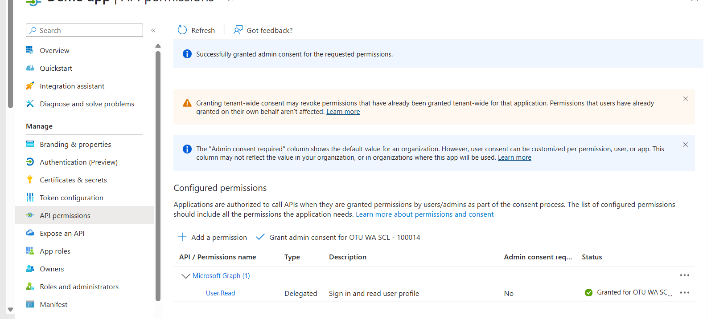
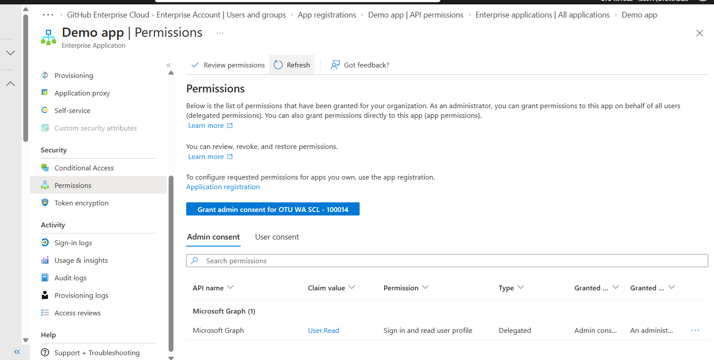

# Week 5 — App Registrations, Enterprise Apps and API Permissions

**Course:** IAM500 — Identity and Access Management  
**Platform:** Microsoft Entra ID / Azure (lab tenant)

## Objective

Register applications with the Microsoft identity platform, expose an API with scopes, assign users to enterprise apps, and grant admin consent for API permissions.

## Lab 19 — App registration

Registered the demo application.

*Figure: Registered app*

Configured the redirect URI.

*Figure: Redirect URI configured*

Set the Application ID URI.

*Figure: Application ID URI saved*

Exposed an API scope.

*Figure: Scope added*

Tried to create a custom role. *Custom roles need Entra ID P1/P2, which the lab tenant did not have.*

*Figure: Custom role creation*

## Lab 20 — Enterprise applications

Created an enterprise application.

*Figure: Enterprise app created*

Assigned a user to it.

*Figure: User assigned*

## Lab 21 — Permissions and consent

Granted tenant-wide admin consent.

*Figure: Admin consent granted*

Added API permissions.

*Figure: Permissions added*

## Key takeaways

- App registration defines the app's identity; the enterprise app (service principal) controls who can use it in the tenant.
- Scopes and admin consent enforce least privilege for APIs.
