# Week 6 — Identity Governance: Entitlement Management, Access Reviews and PIM

**Course:** IAM500 — Identity and Access Management  
**Platform:** Microsoft Entra ID Governance (lab tenant)  
**Labs:** 22 (Entitlement management catalogs), 25 (Access reviews), 26 (Privileged Identity Management)

## Objective

Control **who gets access, for how long, and who checks it**. I bundled resources into a governed catalog (entitlement management), scheduled reviews that re-certify group access for guests and internal users (access reviews), and replaced a standing admin role with a **just-in-time, approval-gated** role (Privileged Identity Management).

## Lab 22 — Entitlement management: resource catalogs

### Why use a resource catalog?
In Microsoft Entra entitlement management, a **resource catalog** is a container for related resources (groups, applications, SharePoint sites) and access packages. It gives:
- **Logical grouping:** related resources and access packages are organised together (by department, project or business unit), so they are easier to manage.
- **Delegated management:** catalog management doesn't have to rely on Global Administrators. The creator becomes the first owner and can add more catalog owners.
- **Package-based access control:** resources must be in a catalog before they can go into access packages, which streamlines provisioning and governance for internal and external users.

### Task 1 — Create a catalog
Created the **Marketing** catalog ("For marketing department users."), enabled, and not enabled for external users.
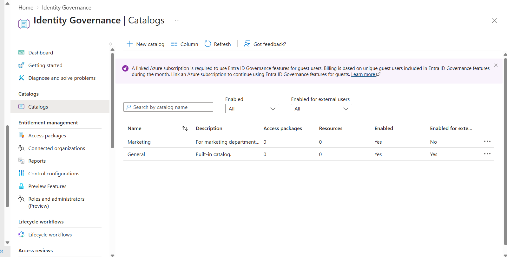
*Figure: Marketing catalog in the catalog list*

### Task 2 — Add resources
Added the **Northwest Sales** group and the **GitHub Enterprise** application to the catalog.

> *Note: the lab tenant had no SharePoint Online sites, so a group and an application were added instead.*
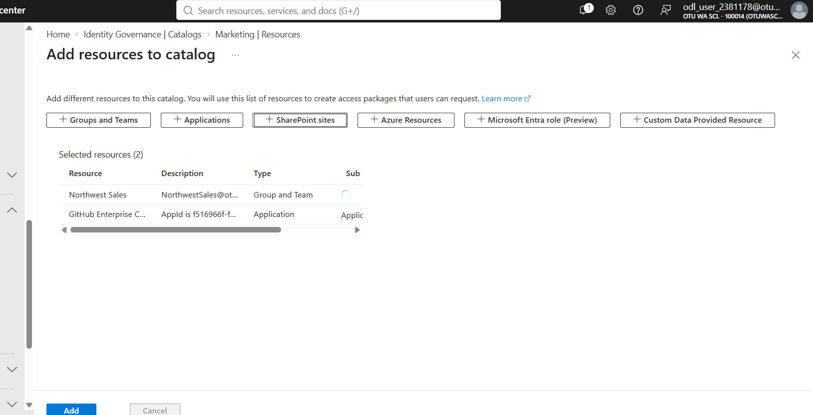
*Figure: Adding a group and an application to the Marketing catalog*

### Task 3 — Delegate ownership
Added **Chris Green as catalog owner**, so a business owner rather than IT manages access to these resources.
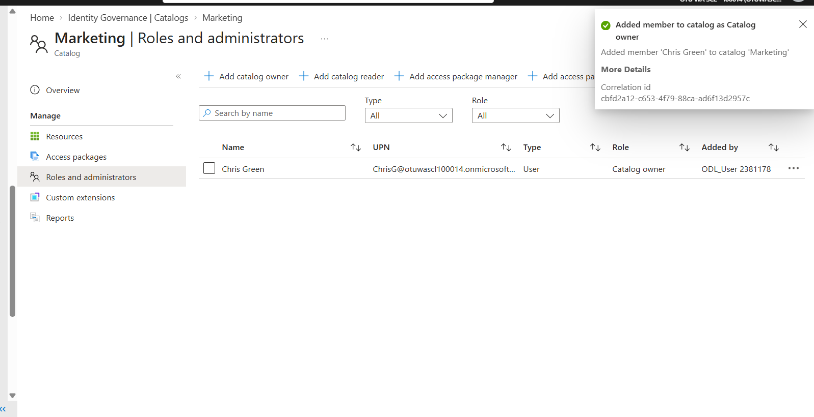
*Figure: Chris Green added as Marketing catalog owner*

### Task 4 — Edit the catalog
Confirmed the catalog properties: **Enabled: Yes**, **Enabled for external users: No**.
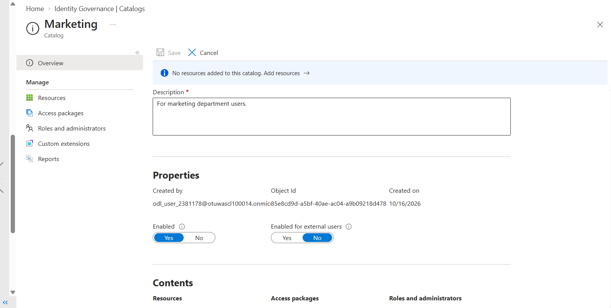
*Figure: Marketing catalog properties*

### Task 5 — Access review for guest users
Created a recurring review, **"Review guest access across Microsoft 365 groups"**, scoped to **guest users only** in all Microsoft 365 groups that have guests. Group owners are the reviewers, results are **auto-applied**, and access is **removed if reviewers don't respond**.
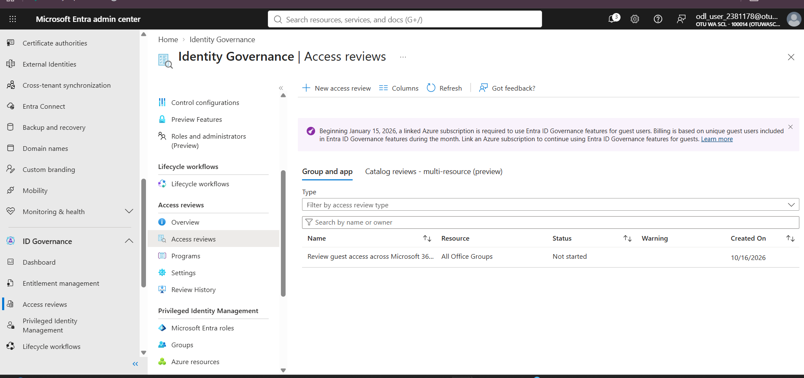
*Figure: Guest-access review across all Office groups*

*Task 6 (deleting the catalog) was cancelled on purpose, to keep the catalog for later labs.*

## Lab 25 — Access reviews for internal users

Created **SC300 Access Review Test**, an internal review of the **Northwest Sales** group (all users), with **Alex Wilber** as reviewer and **annual** recurrence, so membership is re-certified regularly instead of growing forever.

> *Note: the "Sales and Marketing" group named in the lab didn't exist in the tenant, so Northwest Sales was used.*
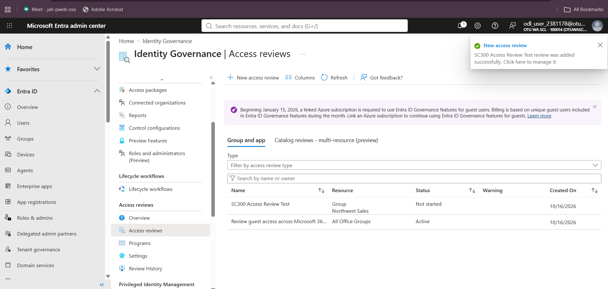
*Figure: SC300 Access Review Test created next to the guest-access review*

## Lab 26 — Privileged Identity Management (PIM)

> *Chris G was used in place of the lab's sample user (Miriam) throughout.*

### Exercise 1 — Configure role settings
Reviewed the **Compliance Administrator** role settings. Activation lasts at most **8 hours** and needs **Azure MFA** and a **justification**.
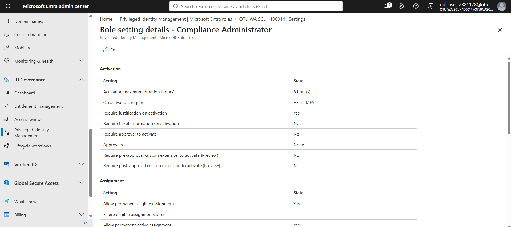
*Figure: PIM role setting details for Compliance Administrator*

Edited the role to **require approval to activate**, with my admin account as approver.
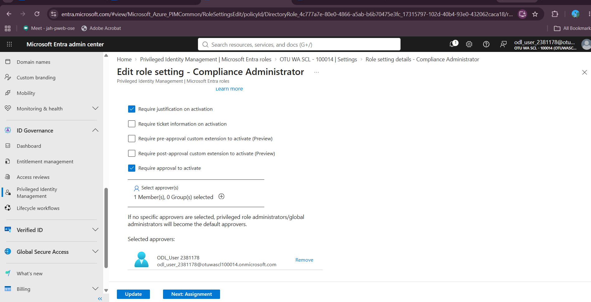
*Figure: Requiring approval for activation, before clicking Update*

### Exercise 2 — Assign, activate and scope roles
**Task 1:** made Chris G **eligible** for Compliance Administrator. It's an eligible assignment, not a permanently active one.
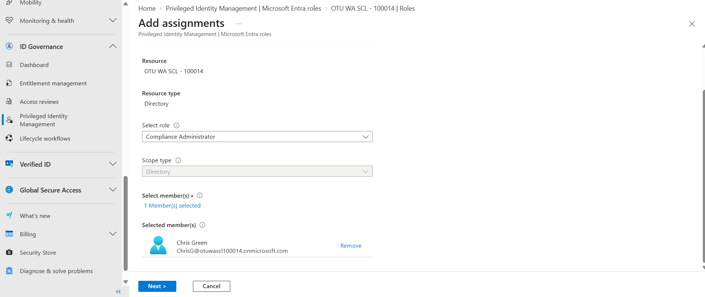
*Figure: Eligible assignment of Compliance Administrator to Chris G*
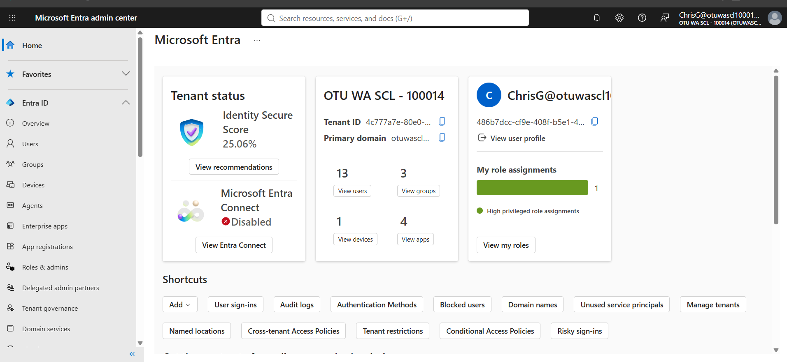
*Figure: Assignment settings*

**Task 2:** signed in as Chris G in a private window. The role shows under **Eligible assignments**, so it gives no privileges until it's activated.
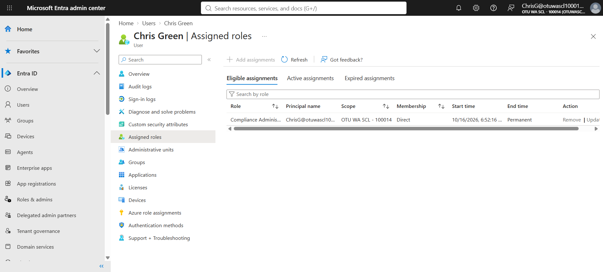
*Figure: Signed in as Chris G: Compliance Administrator is eligible*

**Task 3:** as Chris, activated the role **just in time** for 2 hours, with MFA and a written justification.
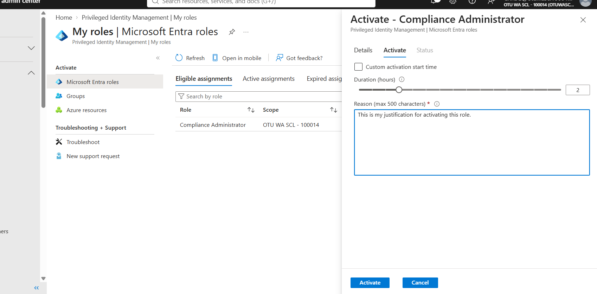
*Figure: Activating Compliance Administrator with duration and justification*

**Task 4:** explored restricting a role's **scope** by preparing a **User Administrator** assignment and reviewing the scope options, then cancelled.
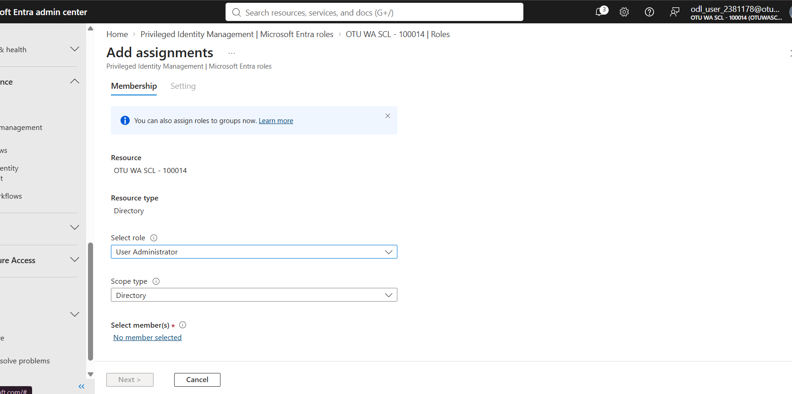
*Figure: User Administrator assignment and scope options*

**Task 5:** removed Chris G's Compliance Administrator assignment to clean up.

## Key takeaways

- **Least privilege over time:** PIM turns standing admin rights into eligible roles that are only active when needed, gated by MFA, a justification, approval and an expiry. That shrinks the window an attacker can abuse.
- **Delegation:** catalogs let resource owners manage access without becoming tenant admins.
- **Recertification:** access reviews catch "access creep". Guest reviews with auto-removal are especially important, because external accounts are easy to forget.
- **Real-world adaptation:** when the lab tenant lacked SharePoint and some sample groups, I picked equivalent resources and documented the substitutions.
- Together these cover the identity lifecycle's governance stage: **request → approve → use → review → remove**.
